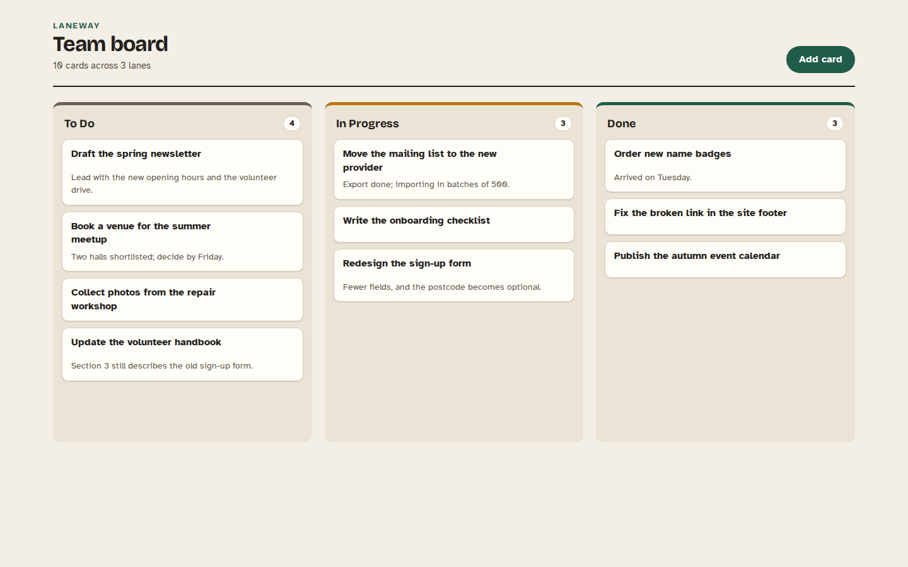
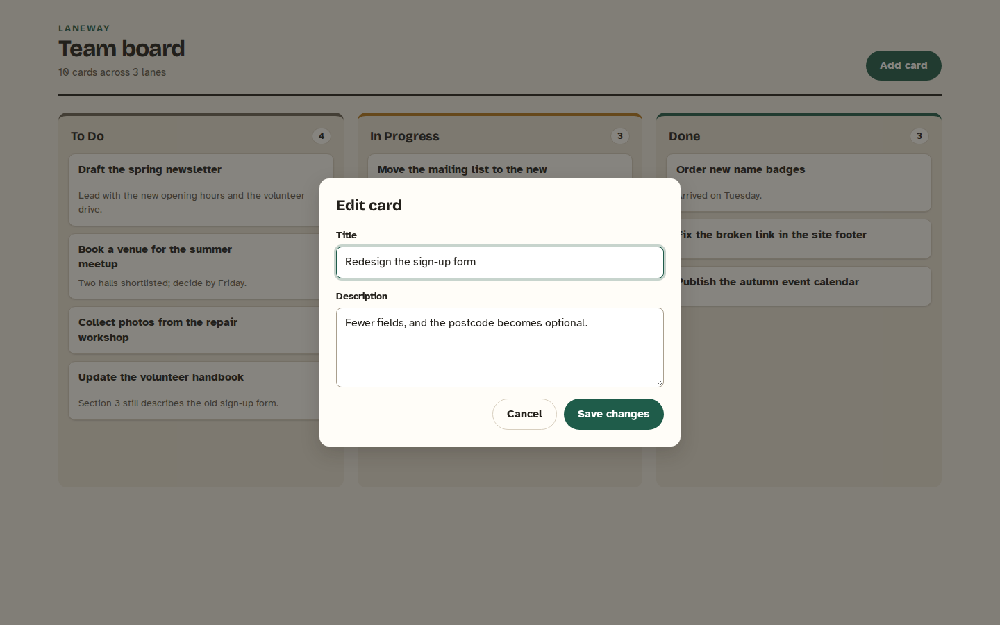
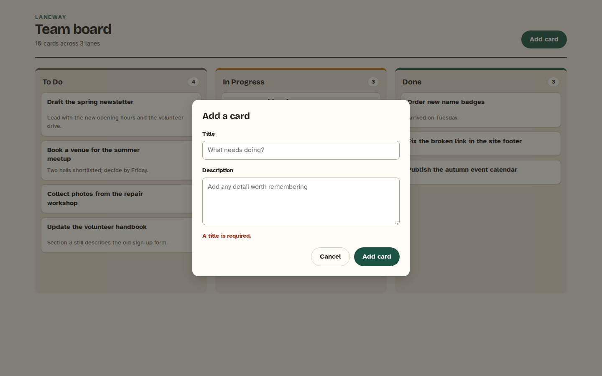
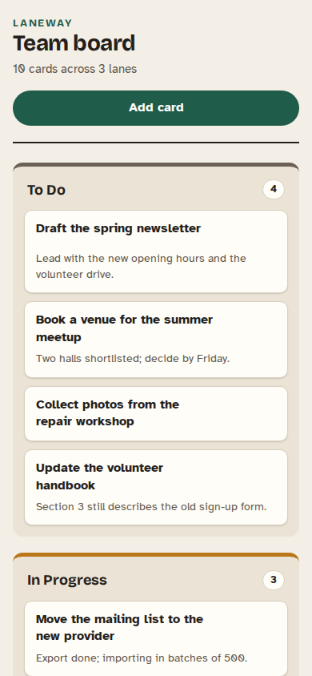
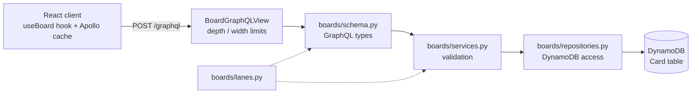

# Laneway

Laneway is a small kanban board: three lanes (To Do, In Progress, Done) and cards you can add, edit, delete and drag between lanes. A React client talks to a Django + Graphene GraphQL API, and the cards are stored in DynamoDB.

It is deliberately small. There is one shared board and no user accounts, so it suits a single team on a trusted network, or serves as a worked example of GraphQL over DynamoDB with a thin service layer. The folders are still called `mini_trello_be/` and `mini_trello_fe/` for historical reasons.



| Editing a card | Validation | Phone (390 px) |
| --- | --- | --- |
|  |  |  |

## Running it

### Docker Compose

```bash
docker compose up --build
docker compose exec backend python manage.py seed_board   # optional demo cards
```

The board is on http://localhost:3000 and GraphQL (with GraphiQL) on http://localhost:8001/graphql. If those ports are taken, set `FRONTEND_PORT`, `BACKEND_PORT` and `DYNAMODB_PORT`:

```bash
FRONTEND_PORT=4000 BACKEND_PORT=4001 DYNAMODB_PORT=4002 docker compose up --build
```

Compose runs three containers: DynamoDB Local (data kept in a named volume), the API (it runs `migrate` and creates the Card table on start) and nginx serving the built client. `docker compose down -v` removes the stored cards.

### Without Docker

You need Python 3.12 and Node 22 (`.python-version` and `.nvmrc` are provided). moto, a dev dependency, stands in for DynamoDB, so no AWS account is needed.

```bash
cd mini_trello_be
python -m venv .venv && source .venv/bin/activate
pip install -r requirements-dev.txt
moto_server -p 8000 &

export DYNAMODB_ENDPOINT_URL=http://localhost:8000
export AWS_ACCESS_KEY_ID=local AWS_SECRET_ACCESS_KEY=local AWS_DEFAULT_REGION=us-west-2
python manage.py migrate
python manage.py init_dynamodb
python manage.py seed_board
python manage.py runserver 0.0.0.0:8001
```

Then, in another terminal:

```bash
cd mini_trello_fe
npm ci
npm run dev        # http://localhost:3000
```

moto keeps everything in memory, so the cards disappear when `moto_server` stops.

## Configuration

Backend settings are read from the environment; `mini_trello_be/.env.example` lists them all. The ones that matter most:

| Variable | Default | Purpose |
| --- | --- | --- |
| `DJANGO_SECRET_KEY` | development fallback | Required once `DJANGO_DEBUG` is off; startup fails without it |
| `DJANGO_DEBUG` | `true` | Also switches GraphiQL, introspection and secure cookies |
| `CORS_ALLOWED_ORIGINS` | `http://localhost:3000` | Origins allowed to call the API |
| `DYNAMODB_ENDPOINT_URL` | unset (real AWS) | DynamoDB Local or moto URL |
| `GRAPHQL_MAX_DEPTH` / `GRAPHQL_MAX_ROOT_FIELDS` | `5` / `10` | Per-request query limits |

The client has one setting, `VITE_GRAPHQL_URL` (see `mini_trello_fe/.env.example`). Vite bakes it into the bundle at build time, so changing it needs a rebuild.

## How it fits together



Each backend layer only talks to the one below it:

- **`lanes.py`** is the single list of lanes. Adding a lane there adds it to validation, the API and the UI. The client draws whatever lanes the server returns.
- **`services.py`** holds the business rules: a title is required (200 characters at most), descriptions are capped at 5,000, the status must be a known lane, and a card id must be non-empty and at most 64 characters.
- **`repositories.py`** is the only code that knows about DynamoDB. Listing follows `LastEvaluatedKey`, because a single scan stops at 1 MB, and hands back an opaque cursor. Cursors are checked before use, so a tampered one restarts the listing instead of reaching boto3.
- **`graphql_view.py`** rejects requests that alias more than 10 root fields or nest deeper than 5 levels, before any scan runs. Introspection is turned off whenever GraphiQL is.

On the client, `src/hooks/useBoard.js` owns all data access. It loads the board 200 cards at a time and follows the cursor until every card is on screen. Moves between lanes are optimistic: the card moves immediately and jumps back, with an alert, if the server refuses. Drag and drop uses `@hello-pangea/dnd`, so cards can also be moved from the keyboard: focus a card, press Space, use the arrow keys, then press Space again.

Request and response examples captured from a running stack are in [docs/api-examples.md](docs/api-examples.md).

## Tests and linting

```bash
cd mini_trello_be
pytest                                   # 98 tests, DynamoDB mocked by moto, no network
ruff check . && ruff format --check .

cd mini_trello_fe
npm run test:ci                          # 20 Vitest + Testing Library tests
npm run lint
npm run build
```

The backend suite goes through the real GraphQL schema and through Django's test client, so it covers the exact queries the client sends, the request limits and the CORS preflight.

The README screenshots come from `npm run screenshots` (Playwright; run `npx playwright install chromium` once first). Run it against a stack seeded with `seed_board --reset` and set `APP_URL` if the board is not on port 3000.

## Known limitations

- **No authentication.** Anyone who can reach the API can read, edit and delete every card. `boards/tests/test_security.py` pins that behaviour so that adding accounts is a deliberate change. Put the app behind a VPN or an authenticating proxy before exposing it.
- **Order within a lane is not saved.** Only moves between lanes reach the server. Cards come back in DynamoDB scan order.
- **Listing is a table scan.** That is fine for a team board with hundreds of cards. Thousands of boards or cards would need a secondary index on `status` and per-lane queries.

## License

MIT; see [LICENSE](LICENSE).
